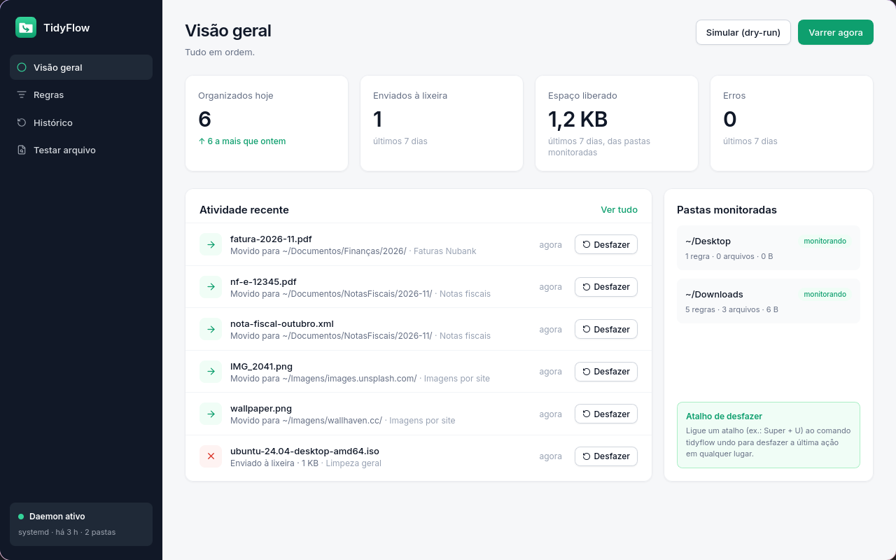
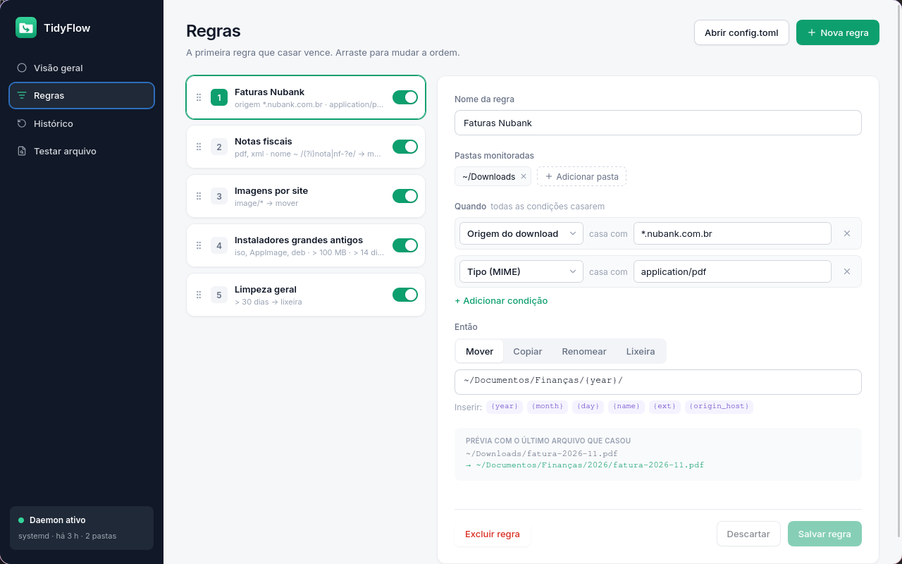
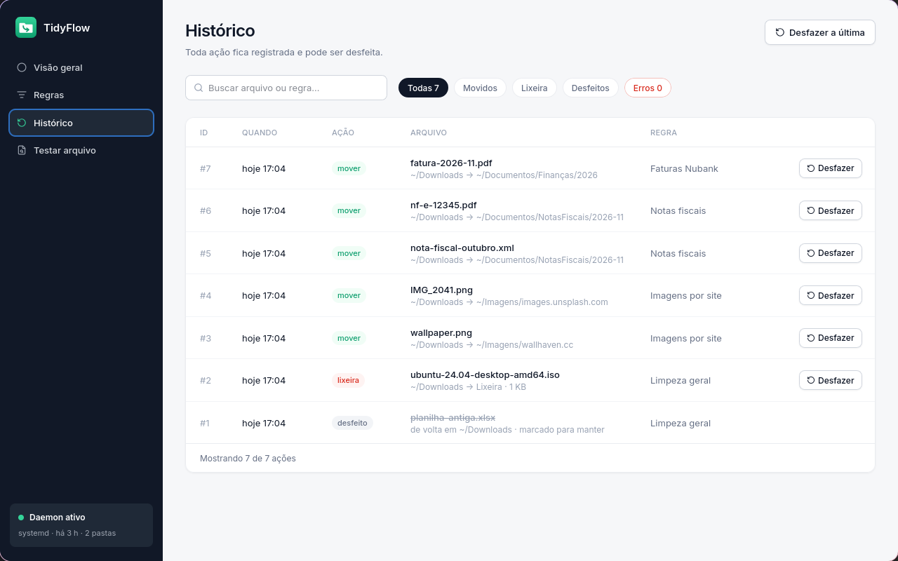
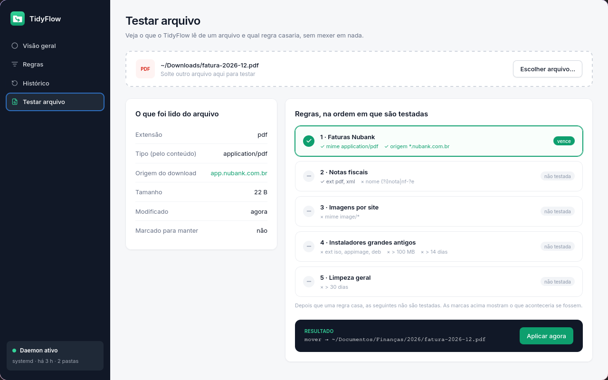

<div align="center">


# TidyFlow

**Your Downloads folder tidies itself.**

Automatic file organizer for Linux. Rules in TOML, everything undoable, nothing overwritten.

[](https://github.com/Langendolff/TidyFlow/releases/latest)
[](https://github.com/Langendolff/TidyFlow/actions/workflows/ci.yml)


[](LICENSE)

[🇧🇷 Versão em português](README.md) · [Download](#download) · [Rules](#rules) · [Context menu](#context-menu)

<br>



<sub>The app UI and the CLI messages are in Brazilian Portuguese.</sub>

</div>

## Why TidyFlow

Most organizers only look at the file extension. TidyFlow also knows **which site the file
came from**, its real type from the content, and how long it has been sitting there. A rule of
a few lines handles the case that bothers you most:

```toml
[[rule]]
name   = "Faturas Nubank"
watch  = ["~/Downloads"]
when   = { origin = "*.nubank.com.br", mime = "application/pdf" }
action = { move = "~/Documentos/Finanças/{year}/" }
```

```
~/Downloads/fatura-2026-11.pdf
        ↓
~/Documentos/Finanças/2026/fatura-2026-11.pdf     [Undo]
```

Every action goes into a history and can be undone from the notification, the terminal or a
keyboard shortcut.

## Features

| | |
|---|---|
| 🌐 **Download origin** | Rules by the site the file came from (`origin = "*.nubank.com.br"`), with the site as a folder variable. |
| 🔍 **MIME from content** | The type is detected by reading the file, not by trusting the extension. |
| 🧹 **Cleanup by age** | `older_than = "30d"` + `trash` keeps the folder clean without deleting anything for good. |
| ↩️ **Everything undoable** | SQLite history, undo from the notification, `tidyflow undo` or a shortcut. |
| 🛡️ **Nothing is overwritten** | If the destination exists, the action fails and is logged as an error. |
| ⏳ **Waits for downloads to finish** | Partial files (`.part`, `.crdownload`) and files still changing are skipped. |
| 🧩 **Browser extension** | Optional, for Firefox and Chromium: reports each download's source page and tells TidyFlow when it finishes. |
| 🖥️ **Optional UI** | Tauri + React app to see activity, edit rules and test a file. |
| 📂 **Context menu** | "Organizar com TidyFlow" and "Testar no TidyFlow" in Nautilus and Nemo. |
| 📴 **100% local** | No accounts, no cloud, no telemetry. |

## Screens

<p align="center">

</p>
<p align="center">
&nbsp;

</p>

Four screens: **Overview** (numbers, recent activity, watched folders, scan or simulate),
**Rules** (edit, pause, drag to reorder), **History** (search, filters, undo) and **Test file**
(what TidyFlow reads from a file and which rule would match).

## Download

Get `TidyFlow-<version>-linux-x64.tar.gz` from the [**Releases**](https://github.com/Langendolff/TidyFlow/releases/latest)
page (Linux x64 with systemd; the UI needs `webkit2gtk-4.1`).

```sh
tar xzf TidyFlow-*-linux-x64.tar.gz
./TidyFlow/install.sh                # binaries in ~/.local/bin, config, launcher, icon and context menu
nano ~/.config/tidyflow/config.toml  # review the rules before starting the daemon
tidyflow check && tidyflow run --dry-run
systemctl --user enable --now tidyflow
```

`install.sh` does not start the daemon: the example rules send anything older than 30 days
in `~/Downloads` to the trash. The package is built by GitHub Actions for each new `v*` tag,
with a `SHA256SUMS.txt` next to it.

## Build from source

Requirements: Rust (2024 edition) and systemd.

```sh
git clone https://github.com/Langendolff/TidyFlow.git
cd TidyFlow

cargo install --path crates/cli
mkdir -p ~/.config/tidyflow
cp config.example.toml ~/.config/tidyflow/config.toml
tidyflow check                       # validate the config
tidyflow run --dry-run               # show what would be done

mkdir -p ~/.config/systemd/user
cp contrib/tidyflow.service ~/.config/systemd/user/
systemctl --user enable --now tidyflow
journalctl --user -u tidyflow -f     # logs
```

## Commands

| Command | What it does |
|---|---|
| `tidyflow daemon` | watches and organizes in real time |
| `tidyflow run [--dry-run]` | scans once |
| `tidyflow organize FILE...` | organizes the given files now (used by the context menu) |
| `tidyflow undo [ID]` | undoes the last action (or action ID) |
| `tidyflow history [-n N]` | latest actions |
| `tidyflow check [FILE]` | validates the config / shows which rule would match |
| `tidyflow browser install` | registers the browser extension's host (`uninstall` removes it) |

Hyprland: `bind = SUPER, U, exec, tidyflow undo` to undo from the keyboard.

## Rules

See [`config.example.toml`](config.example.toml) for a full config.

| | |
|---|---|
| **Conditions** (all must match) | `ext`, `name` (glob), `name_regex`, `mime` (glob), `origin` (host glob), `site` (glob of the source page's host), `size_gt`, `size_lt` (`"100MB"`, `"1MiB"`), `older_than` (`"30d"`, `"12h"`) |
| **Actions** (one per rule) | `move`, `copy`, `rename`, `trash` |
| **Variables** | `{year}` `{month}` `{day}` (modification date), `{ext}`, `{name}`, `{origin_host}`, `{site}` |

The first matching rule wins. `enabled = false` pauses a rule without deleting it. Each rule
needs a unique name. A `rename` rule whose result still matches the same rule renames the
file again on every scan: add a condition that excludes names already renamed.

A `watch` folder that doesn't exist yet is not an error: `check` warns, and the daemon
starts watching it once it appears (retrying every 60s).

### Download origin

Read from the `user.xdg.origin.url` extended attribute. Written by: Chromium/Chrome,
`wget --xattr`, `curl --xattr` and, on Firefox, by the [browser extension](#browser-extension).

`origin` is the host the file was downloaded from, which is often a CDN
(`objects.githubusercontent.com`). `site` is the host of the page you clicked on
(`github.com`), read from `user.xdg.referrer.url`; without it, `site` uses the origin.

### Undo

Undo is final for that file: TidyFlow writes the `user.tidyflow.keep` xattr on the restored
file and leaves it alone from then on. Where the xattr can't be written, the history is used
instead. To let TidyFlow organize the file again: `setfattr -x user.tidyflow.keep <file>`.
`tidyflow check <file>` shows whether the file is marked.

## UI

The UI does not talk to the daemon: it reads the same history and edits the same
`config.toml`, which the daemon reloads on its own. The editor keeps the comments and
formatting of the rest of the file, and won't save if the file changed on disk since it was
opened. If `config.toml` is a symlink (dotfiles), it stays one.

Requirements: `webkit2gtk-4.1` and Node 22 or newer.

```sh
npm --prefix ui ci
npm --prefix ui run build
cargo build --release -p tidyflow-app --features custom-protocol
install -Dm755 target/release/tidyflow-app ~/.cargo/bin/tidyflow-app
install -Dm644 contrib/tidyflow.desktop ~/.local/share/applications/tidyflow.desktop
install -Dm644 crates/app/icons/128x128.png ~/.local/share/icons/hicolor/128x128/apps/tidyflow.png
```

Development: `npm --prefix ui run dev` in one terminal and `cargo run -p tidyflow-app` in
another (the window loads Vite with hot reload).

## Context menu

Two entries: **Organizar com TidyFlow** (`tidyflow organize`) and **Testar no TidyFlow**
(opens the Test file screen; if the app is already open, it just switches the file).

```sh
# Nautilus: shows up under Scripts → TidyFlow
mkdir -p ~/.local/share/nautilus/scripts
cp -r contrib/nautilus/TidyFlow ~/.local/share/nautilus/scripts/

# Nemo
mkdir -p ~/.local/share/nemo/actions
cp contrib/nemo/*.nemo_action ~/.local/share/nemo/actions/
```

`organize` is an explicit request, so it differs from the daemon: it works on **any folder**
(the rules' `watch` is ignored), doesn't wait for the file to settle, and ignores the undone
mark (which is removed). Be careful with broad rules like `older_than` + `trash`: they also
apply to an old file in another folder. The action goes into the history and can be undone
from the notification, like the others.

## Browser extension

Optional. Tells TidyFlow each download's URL, source page and tab title, and when it
finishes. With it, `origin` and `site` rules work on Firefox, and the daemon knows exactly
when it can touch the file instead of guessing from `.part` files.

```sh
tidyflow browser install   # install.sh already does this
```

Then install the extension: on Firefox, the `.xpi` from the release; on Chromium, Chrome or
Brave, unzip the release zip and load it in `chrome://extensions` (developer mode → load
unpacked). Details in [`browser/README.md`](browser/README.md).

The extension only observes: it doesn't download, move or rename anything. Downloads from
private windows are never reported. It talks to the `tidyflow` binary on your computer
through native messaging, with no network.

## Architecture

```
TidyFlow/
├── crates/
│   ├── core/   # rules, metadata, actions, history (SQLite), undo
│   ├── cli/    # `tidyflow` binary: daemon, run, organize, undo, history, check
│   └── app/    # `tidyflow-app` binary: Tauri 2
├── ui/         # React + Vite + Tailwind, the app's UI
├── browser/    # browser extension (WebExtension, TypeScript)
└── contrib/    # systemd unit, .desktop, install.sh, Nautilus scripts and Nemo actions
```

The daemon, the CLI and the app share the same `core`, so a rule behaves the same everywhere.

**Stack:** Rust · Tauri 2 · React 19 · Vite · Tailwind · SQLite (rusqlite) · TOML

## License

TidyFlow is an educational project released under the [PolyForm Noncommercial 1.0.0](LICENSE).

- **Allowed without asking:** studying, teaching, research, modifying and using it for personal purposes or in schools, non-profits and public institutions.
- **Commercial use** (selling it, including it in a paid product, using it in a for-profit company) requires written permission. [Open an issue](https://github.com/Langendolff/TidyFlow/issues) or contact the author on [GitHub](https://github.com/Langendolff).

## Status

Version `0.1.0`, early stage. Built for personal use; still has rough edges.
Suggestions and bug reports are welcome in the [Issues](https://github.com/Langendolff/TidyFlow/issues).

---

<p align="center">Made by <a href="https://github.com/Langendolff">Lorenzo Langendolff</a></p>
