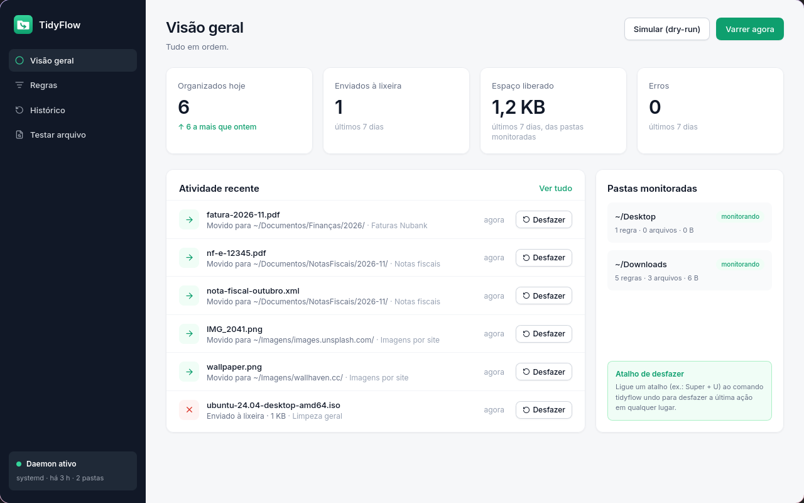
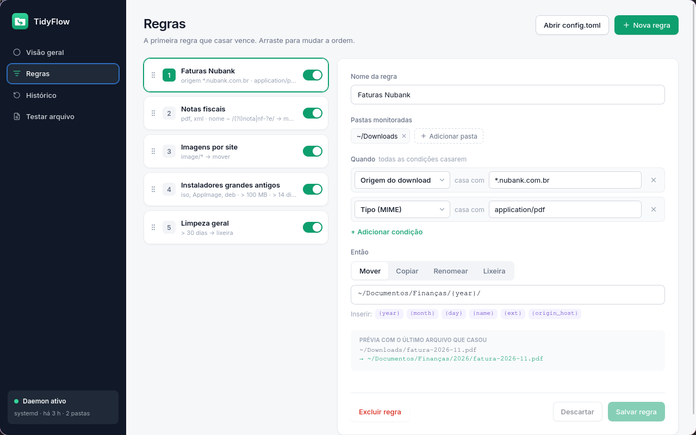
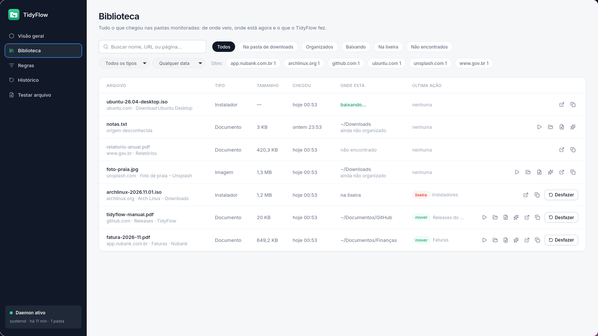
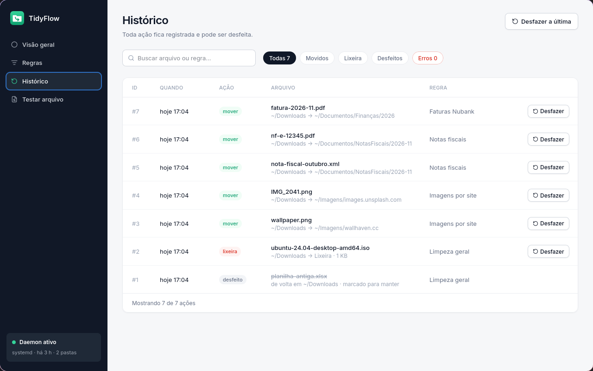
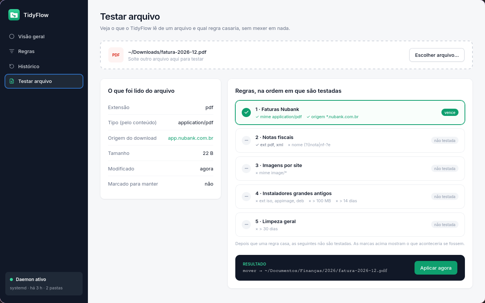

<div align="center">


# TidyFlow

**Sua pasta de Downloads se organiza sozinha.**

Organizador automático de arquivos para Linux. Regras em TOML, tudo desfazível, nada sobrescrito.

[](https://github.com/Langendolff/TidyFlow/releases/latest)
[](https://github.com/Langendolff/TidyFlow/actions/workflows/ci.yml)


[](LICENSE)

[🇺🇸 English version](README.en.md) · [Baixar](#download) · [Regras](#regras) · [Menu de contexto](#menu-de-contexto)

<br>



</div>

## Por que o TidyFlow

Organizadores comuns olham só para a extensão. O TidyFlow também sabe **de qual site o
arquivo veio**, qual é o tipo real pelo conteúdo e há quanto tempo ele está parado. Uma regra
de poucas linhas resolve o caso que mais incomoda:

```toml
[[rule]]
name   = "Faturas Nubank"
watch  = ["~/Downloads"]
when   = { origin = "*.nubank.com.br", mime = "application/pdf" }
action = { move = "~/Documentos/Finanças/{year}/" }
```

```
~/Downloads/fatura-2026-11.pdf
        ↓
~/Documentos/Finanças/2026/fatura-2026-11.pdf     [Desfazer]
```

Cada ação vai para um histórico e pode ser desfeita pela notificação, pelo terminal ou por
um atalho de teclado.

## Funcionalidades

| | |
|---|---|
| 🌐 **Origem do download** | Regras pelo site de onde o arquivo veio (`origin = "*.nubank.com.br"`), com a pasta do site como variável. |
| 🔍 **MIME pelo conteúdo** | O tipo é detectado lendo o arquivo, não confiando na extensão. |
| 🧹 **Limpeza por idade** | `older_than = "30d"` + `trash` mantém a pasta limpa sem apagar nada de vez. |
| ↩️ **Tudo desfazível** | Histórico em SQLite, desfazer pela notificação, por `tidyflow undo` ou por atalho. |
| 🛡️ **Nada é sobrescrito** | Se o destino já existe, a ação falha e fica registrada como erro. |
| ⏳ **Espera o download terminar** | Arquivos parciais (`.part`, `.crdownload`) e arquivos ainda mudando são ignorados. |
| 🧩 **Extensão de navegador** | Opcional, para Firefox e Chromium: informa a página de origem de cada download e avisa quando ele termina. |
| 🖥️ **Interface opcional** | App Tauri + React para ver a atividade, editar regras e testar um arquivo. |
| 📂 **Menu de contexto** | "Organizar com TidyFlow" e "Testar no TidyFlow" no Nautilus e no Nemo. |
| 📴 **100% local** | Sem contas, sem nuvem, sem telemetria. |

## Telas

<p align="center">

</p>
<p align="center">

</p>
<p align="center">
&nbsp;

</p>

Cinco telas: **Visão geral** (números, atividade recente, pastas monitoradas, varrer ou
simular), **Biblioteca** (tudo o que chegou nas pastas monitoradas: de que site veio, onde
está agora e o que o TidyFlow fez, com busca e filtros), **Regras** (editar, pausar, arrastar para reordenar), **Histórico** (busca,
filtros, desfazer) e **Testar arquivo** (o que o TidyFlow lê de um arquivo e qual regra
casaria).

## Download

Baixe `TidyFlow-<versão>-linux-x64.tar.gz` na página de [**Releases**](https://github.com/Langendolff/TidyFlow/releases/latest)
(Linux x64 com systemd; a interface precisa de `webkit2gtk-4.1`).

```sh
tar xzf TidyFlow-*-linux-x64.tar.gz
./TidyFlow/install.sh                # binários em ~/.local/bin, config, atalho, ícone e menu de contexto
nano ~/.config/tidyflow/config.toml  # revise as regras antes de ligar o daemon
tidyflow check && tidyflow run --dry-run
systemctl --user enable --now tidyflow
```

O `install.sh` não liga o daemon sozinho: as regras de exemplo mandam para a lixeira o que
está há mais de 30 dias em `~/Downloads`. O pacote é gerado pelo GitHub Actions a cada nova
tag `v*`, com um `SHA256SUMS.txt` ao lado.

## Compilar a partir do código

Requisitos: Rust (edição 2024) e systemd.

```sh
git clone https://github.com/Langendolff/TidyFlow.git
cd TidyFlow

cargo install --path crates/cli
mkdir -p ~/.config/tidyflow
cp config.example.toml ~/.config/tidyflow/config.toml
tidyflow check                       # valida o config
tidyflow run --dry-run               # mostra o que seria feito

mkdir -p ~/.config/systemd/user
cp contrib/tidyflow.service ~/.config/systemd/user/
systemctl --user enable --now tidyflow
journalctl --user -u tidyflow -f     # logs
```

## Comandos

| Comando | O que faz |
|---|---|
| `tidyflow daemon` | monitora e organiza em tempo real |
| `tidyflow run [--dry-run]` | varre uma vez |
| `tidyflow organize ARQUIVO...` | organiza os arquivos dados agora (usado pelo menu de contexto) |
| `tidyflow undo [ID]` | desfaz a última ação (ou a ação ID) |
| `tidyflow history [-n N]` | últimas ações |
| `tidyflow check [ARQUIVO]` | valida o config / mostra qual regra casaria |
| `tidyflow browser install` | registra o host da extensão de navegador (`uninstall` remove) |

Hyprland: `bind = SUPER, U, exec, tidyflow undo` para desfazer pelo teclado.

## Regras

Veja [`config.example.toml`](config.example.toml) para um config completo.

| | |
|---|---|
| **Condições** (todas precisam casar) | `ext`, `name` (glob), `name_regex`, `mime` (glob), `origin` (glob do host), `site` (glob do site da página de origem), `size_gt`, `size_lt` (`"100MB"`, `"1MiB"`), `older_than` (`"30d"`, `"12h"`) |
| **Ações** (uma por regra) | `move`, `copy`, `rename`, `trash` |
| **Variáveis** | `{year}` `{month}` `{day}` (data de modificação), `{ext}`, `{name}`, `{origin_host}`, `{site}` |

A primeira regra que casar vence. `enabled = false` pausa uma regra sem apagá-la.
Cada regra precisa de um nome único. Uma regra `rename` cujo resultado continua casando
com a própria regra renomeia o arquivo de novo a cada varredura: inclua uma
condição que exclua os nomes já renomeados.

Uma pasta `watch` que ainda não existe não é erro: `check` avisa, e o daemon passa
a monitorá-la quando ela aparecer (tenta de novo a cada 60s).

### Origem do download

Lida do atributo estendido `user.xdg.origin.url`. Gravado por: Chromium/Chrome,
`wget --xattr`, `curl --xattr` e, no Firefox, pela [extensão de navegador](#extensão-de-navegador).

`origin` é o host de onde o arquivo foi baixado, que muitas vezes é uma CDN
(`objects.githubusercontent.com`). `site` é o host da página onde você clicou
(`github.com`), lido de `user.xdg.referrer.url`; sem ela, `site` usa a origem.

### Desfazer

Desfazer é definitivo para aquele arquivo: o TidyFlow grava o xattr
`user.tidyflow.keep` no arquivo restaurado e não mexe nele de novo. Onde o xattr
não puder ser gravado, o histórico é usado no lugar. Para o TidyFlow organizar o
arquivo de novo: `setfattr -x user.tidyflow.keep <arquivo>`. `tidyflow check <arquivo>`
mostra se o arquivo está marcado.

## Interface

A interface não conversa com o daemon: ela lê o mesmo histórico e edita o mesmo
`config.toml`, que o daemon recarrega sozinho. O editor mantém os comentários e a
formatação do resto do arquivo, e não grava se o arquivo mudou no disco desde que foi
aberto. Se o `config.toml` for um symlink (dotfiles), ele continua sendo.

Requisitos: `webkit2gtk-4.1` e Node 22 ou mais novo.

```sh
npm --prefix ui ci
npm --prefix ui run build
cargo build --release -p tidyflow-app --features custom-protocol
install -Dm755 target/release/tidyflow-app ~/.cargo/bin/tidyflow-app
install -Dm644 contrib/tidyflow.desktop ~/.local/share/applications/tidyflow.desktop
install -Dm644 crates/app/icons/128x128.png ~/.local/share/icons/hicolor/128x128/apps/tidyflow.png
```

Desenvolvimento: `npm --prefix ui run dev` num terminal e `cargo run -p tidyflow-app`
em outro (a janela carrega o Vite com recarga automática).

## Menu de contexto

Dois itens: **Organizar com TidyFlow** (`tidyflow organize`) e **Testar no TidyFlow**
(abre a tela Testar arquivo; com o app já aberto, só troca o arquivo).

```sh
# Nautilus: aparece em Scripts → TidyFlow
mkdir -p ~/.local/share/nautilus/scripts
cp -r contrib/nautilus/TidyFlow ~/.local/share/nautilus/scripts/

# Nemo
mkdir -p ~/.local/share/nemo/actions
cp contrib/nemo/*.nemo_action ~/.local/share/nemo/actions/
```

`organize` é um pedido explícito, então ele é diferente do daemon: vale para
**qualquer pasta** (o `watch` das regras é ignorado), não espera o arquivo ficar
parado e ignora a marca de desfeito (que é removida). Cuidado com regras amplas como
`older_than` + `trash`: elas também valem para um arquivo antigo de outra pasta. A
ação vai para o histórico e pode ser desfeita pela notificação, como as outras.

## Extensão de navegador

Opcional. Informa ao TidyFlow a URL, a página de origem e o título da aba de cada
download, e avisa quando ele termina. Com ela, as regras por `origin` e `site`
funcionam no Firefox, e o daemon sabe exatamente quando pode mexer no arquivo, em
vez de adivinhar pelos arquivos `.part`.

```sh
tidyflow browser install   # o install.sh já faz isso
```

Depois, instale a extensão: no Firefox, o `.xpi` do release; no Chromium, Chrome ou
Brave, o zip do release descompactado em `chrome://extensions` (modo do
desenvolvedor → carregar sem compactação). Detalhes em [`browser/README.md`](browser/README.md).

A extensão só observa: não baixa, não move e não renomeia nada. Downloads de janelas
privadas nunca são informados. A comunicação é com o binário `tidyflow` no seu
computador, por native messaging, sem rede.

## Arquitetura

```
TidyFlow/
├── crates/
│   ├── core/   # regras, leitura de metadados, ações, histórico (SQLite), desfazer
│   ├── cli/    # binário `tidyflow`: daemon, run, organize, undo, history, check
│   └── app/    # binário `tidyflow-app`: Tauri 2
├── ui/         # React + Vite + Tailwind, a interface do app
├── browser/    # extensão de navegador (WebExtension, TypeScript)
└── contrib/    # unit do systemd, .desktop, install.sh, scripts do Nautilus e ações do Nemo
```

O daemon, a CLI e o app usam o mesmo `core`, então uma regra se comporta igual em todos.

**Stack:** Rust · Tauri 2 · React 19 · Vite · Tailwind · SQLite (rusqlite) · TOML

## Licença

O TidyFlow é um projeto educacional distribuído sob a [PolyForm Noncommercial 1.0.0](LICENSE).

- **Permitido sem pedir autorização:** estudar, ensinar, pesquisar, modificar e usar para fins pessoais ou em instituições de ensino, ONGs e órgãos públicos.
- **Uso comercial** (vender, incluir em produto pago, usar em empresa com fins lucrativos) só com autorização por escrito. Para isso, [abra uma issue](https://github.com/Langendolff/TidyFlow/issues) ou fale com o autor pelo [GitHub](https://github.com/Langendolff).

## Status

Versão `0.1.0`, em estágio inicial. Feito para uso pessoal; ainda tem arestas.
Sugestões e problemas são bem-vindos nas [Issues](https://github.com/Langendolff/TidyFlow/issues).

---

<p align="center">Feito por <a href="https://github.com/Langendolff">Lorenzo Langendolff</a></p>
